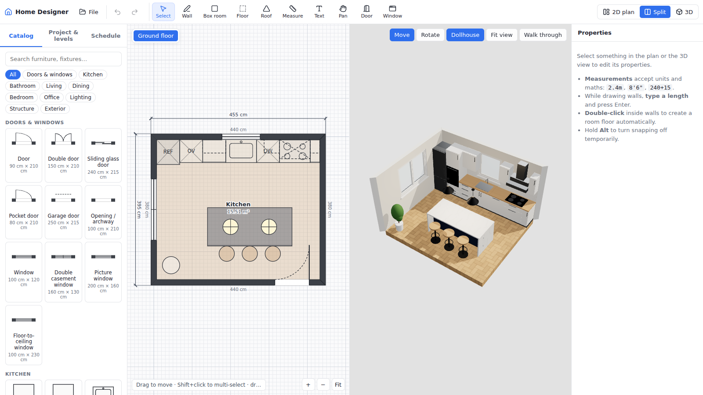
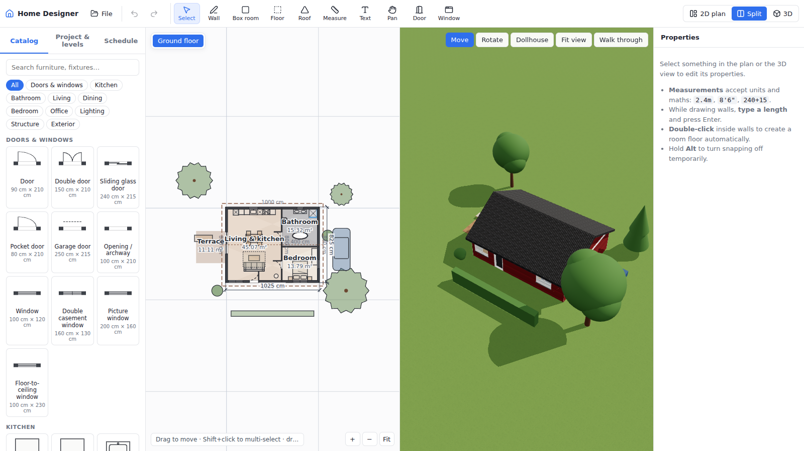
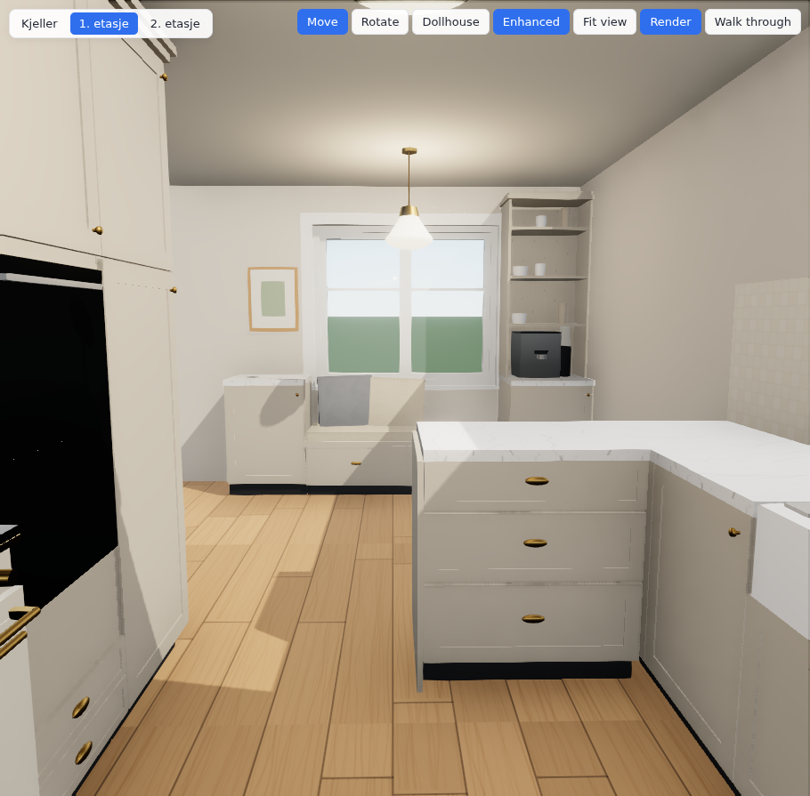

# Home Designer

A browser-based interior and exterior design tool for planning kitchens, bathrooms and whole houses. You draw the floor plan in 2D, with exact measurements, and see it rendered live in 3D.

It runs fully locally: no account, no server. Projects are autosaved in the browser and can be saved/opened as `.home.json` files.

## Features

**Floor plan (2D)**
- Walls: click-to-draw chains with snapping to end points, walls, 15° angles, alignment guides and the grid. **Type an exact length while drawing** (`420`, `4.2m`, `13'9"`, `300+120`) and press Enter.
- Wall corners are mitred automatically. T-junctions and crossings are supported. Walls can have a sloped top (e.g. knee walls under a slanted roof) and a separate finish on each side.
- **Box room** tool: drag a rectangle to get four walls and a floor in one go.
- **Floor** tool: draw a floor polygon, or **double-click inside walls** to detect the room automatically. Rooms show name, area and perimeter.
- Doors (single, double, sliding, pocket, garage, archway) and windows (casement, double, picture, floor-to-ceiling). They attach to walls, slide along them, and doors swing towards the side you insert them from.
- Dimension lines, automatic wall lengths, text labels.
- Select, multi-select (Shift / box select), move, rotate and resize handles. Live clearances show the distance from the selected object to the surrounding walls.
- Magnetic furniture: cabinets and fixtures snap their back against walls and line up with each other and with perpendicular walls. This is ideal for kitchen runs.
- Multiple levels, with the level below shown faintly for reference. "Add level (copy)" duplicates walls, rooms and windows upstairs.

**Roofs**
- Flat, shed/mono-pitch (slanted), gable, hip (becomes a pyramid on square plans), gambrel (barn) and mansard.
- Pitch, overhang, eave height, thickness, rotation and ridge direction. Optional gable-end infill walls.
- Readouts for ridge height and sloped roof area. Click the roof tool once to cover all walls automatically.

**3D view**
- Live 3D model with sun and sky, soft shadows, reflections and a procedural material library: wood floors, herringbone, tiles, marble, terrazzo, brick, wood cladding, render, roof tiles, slate, standing seam, grass and more. You can also pick any custom colour.
- Around 70 parametric objects:
  - Kitchen: base, drawer, sink, cooktop and corner units, wall and tall units, oven tower, fridge, range, hood, island, worktop, backsplash, stools, farmhouse sink, classic range cooker, painted mantel hood, hutch with open shelves, pot rail, espresso machine
  - Cabinets and furniture can have flat or **shaker** fronts, with handles and taps in steel, brass, black and other metals
  - Bathroom: toilets, vanities, basins, built-in and freestanding tubs, shower enclosure, walk-in screen, mirror cabinet, towel radiator, washing machine
  - Living, dining, bedroom, office and lighting furniture, with lamps that emit light
  - Structure: stairs, columns, beams, slabs, generic box/cylinder, radiators
  - Exterior: trees, conifers, shrubs, hedges, fences, decks, pergola, pool, sun loungers, car
- Click objects in 3D to select them. Move or rotate them with the gizmo, including height.
- **Dollhouse** mode hides the walls facing the camera, so you can look into rooms. **Cutaway** lowers the walls on the current level.
- **Walk-through** first-person mode (WASD + mouse).

**Output**
- Schedule / bill of quantities: rooms with areas, doors & windows, furniture grouped by type with sizes and finishes. Exports to CSV.
- Export the 3D render as PNG, the 3D model as **GLB** (Blender, Unreal, Twinmotion…) or **COLLADA .dae** for SketchUp, the floor plan as **SVG**, or **print** the plan / save it as PDF. Model exports always contain the whole building and garden, whatever the current view shows.
  - **SketchUp:** File → Import → COLLADA (*.dae). The model comes in at real size (metres), with each piece of furniture as its own group named after it, and one material per finish. Materials are flat colours; the wood, tile and brick patterns are not included (use GLB in Blender for textures).
  - **FreeCAD:** File → *3D model for FreeCAD (macro)* saves an `.FCMacro`. In FreeCAD choose Macro → Macros… → the file → Execute. It builds a new document of native objects: each piece of furniture, door and window is an App::Part (move it by its Placement) made of Part boxes, cylinders, cones, ellipsoids and wedges whose sizes stay editable; walls, floors and roofs become solids. Everything is grouped by level and kind, named and coloured, in millimetres with Z up. Running it with `FreeCADCmd` saves an `.FCStd` next to the macro.
- **Drawings:** File → *Drawings: plan + wall elevations (A3 PDF)* makes a drawing set for the current level: a plan with elevation markers, then an elevation of every wall that has furniture against it. They are true-scale A3 sheets (1:20 or 1:25 for elevations) with a title block, cabinet fronts, handles, hoods and windows, and dimension chains in mm: unit widths along the floor, the overall length, window positions along the top, and worktop, hood and cabinet heights at the side. Select a wall and use *Elevation* or *SVG* in its properties for that wall alone.
